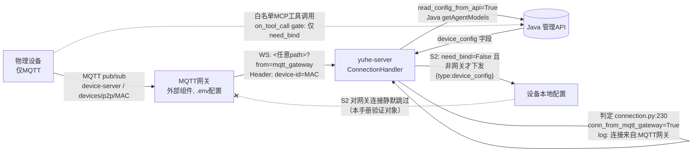

# P1-5 MQTT 网关 device_config 透传真机实测手册

> 对应交付报告 P1 第 5 条「MQTT 网关透传实测」。
> 契约背景：连接标记 `conn_from_mqtt_gateway=True` 时，云端设备配置**下发**保守跳过（yuhe-server/core/connection.py:924，design §6 风险4），真机透传未实测。
> 本手册全部代码走读结论 + 部署机可执行的验证步骤。每条命令均标注「需人工在部署机执行」。

---

## 1. 代码走读结论（只读，未改动源码）

### 1.1 `conn_from_mqtt_gateway` 从哪里来

| 位置 | 说明 |
|---|---|
| `core/connection.py:195` | 默认 `False`，每连接实例字段 |
| `core/connection.py:229-232` | `handle_connection` 中判定：`ws.request.path.endswith("?from=mqtt_gateway")`。命中打日志「**连接来自:MQTT网关**」 |
| `core/websocket_server.py:76-83` | WS 服务用 `websockets.serve(handler, host, port)` 监听，**不按路径过滤**，任意 path 均进 `ConnectionHandler`；gateway 客户端连接时自带 `?from=mqtt_gateway` 查询串 |

判定链路：MQTT 网关（外部组件，见 config.yaml `server.mqtt_gateway` 注释「根据mqtt_gateway的.env文件配置」）以 **WS 客户端**身份连到 yuhe-server，URL 追加 `?from=mqtt_gateway`，请求头带 `device-id: <MAC>`；物理设备只与网关说 MQTT（topic：`device-server` 上行 / `devices/p2p/{MAC}` 下行，见 `core/api/ota_handler.py:272-279` 的 OTA 下发结构）。

### 1.2 跳过点全清单（conn_from_mqtt_gateway=True 时）

| # | 位置 | 行为 | 日志断言点 |
|---|---|---|---|
| S1 | `core/connection.py:377-380` | 音频字节 ≥16B → `_process_mqtt_audio_message`（解析16字节头，AEC echo 时间戳），失败再回落裸 opus 解码 | 解析失败打「解析WebSocket音频包失败: …」 |
| S2 | `core/connection.py:924` | **device_config 下发跳过**（`if not need_bind and not conn_from_mqtt_gateway`；裁决 c 后跳过分支打日志「跳过云端设备配置下发 (device …)：MQTT网关透传（保守策略…）」/「设备未绑定」） | 放行时打「已下发云端设备配置: …」 |
| S3 | `core/handle/sendAudioHandle.py:270-277` | TTS opus 包**加16字节头**再经 WS 发给网关（非网关直发裸 opus） | 无可观测日志；用抓包/脚本断言首字节=0x01 |

16字节头布局（`sendAudioHandle.py:107-115`）：`[0]=1(type) [2:4]=len [4:8]=seq [8:12]=timestamp [12:16]=opus_len`，后跟 opus payload。上行音频同构（`connection.py:399` 读 `[8:12]` 时间戳）。

### 1.3 上报侧 gate（历史偏差 → 已由裁决 b 收敛）

`core/providers/tools/device_config_sync.py` 的 `on_tool_call`（由 `device_mcp/mcp_executor.py:30` 在每次设备 MCP 工具调用入口调用）：

- 原 gate 只查 `need_bind` 与 `read_config_from_api`，不检查 `conn_from_mqtt_gateway`——曾出现「上报放行、下发跳过」的不对称。
- **裁决 b 已实施**（2026-10）：`on_tool_call` 追加 `conn_from_mqtt_gateway` 跳过分支（现 L93，跳过时打日志「设备配置上报跳过：… 来自MQTT网关连接（保守策略）」），白名单工具（`self_audio_speaker_set_volume` / `self_screen_set_brightness`，`DEVICE_CONFIG_TOOL_RULES` L25-41）在网关连接下一律不上报（`POST /config/device-config`，`config/manage_api_client.py:306`）。
- 注意：`on_tool_call` 在 `mcp_executor.py:30` 先于 mcp_client 判空执行，gate 判定与 mcp_client 是否初始化无关（单测已覆盖）。

### 1.4 need_bind 交互

`connection.py:802-832`：`read_config_from_api=True` 时网关连接也会走 Java `getAgentModels` 查绑定态；未绑定 → `need_bind=True` → `_route_message`（L353-366）丢弃所有消息并周期播绑定提示。因此 S2 实际生效前提是「网关设备的 MAC 已在管理端绑定」。

### 1.5 链路图（Mermaid）



---

## 2. 前置条件

1. yuhe-server 已部署且 `config.yaml` 中 `read_config_from_api: true`，Java 管理 API 可达。
2. 目标 MAC（下例用 `AA:BB:CC:DD:EE:FF`）已在 Kawaii 管理端绑定，并在控制台写入 device_config（如 `{"volume": 40}`）——这是验证「下发跳过」的前置（S2 对未写配置的本就不发）。
3. 网关二选一：
   - **方案 A（真机链路）**：官方 `yuhe-mqtt-gateway` 组件 + EMQX/Mosquitto，`server.mqtt_gateway` 配置为 `host:port`；
   - **方案 B（最小模拟，推荐先做）**：直接用下面 §4 脚本模拟「网关 WS 客户端」，不依赖真实 MQTT，可 100% 复现服务端判定与日志，覆盖 S2/S3 的服务端侧行为。真实 MQTT 只多一层「网关是否原样转发自定义 text type」的问题（见 §5 R1），B 方案验完后用 A 补真机端到端。

## 3. 最小验证脚本（方案 B）

> 保存为 `/opt/xiaozhi/verify_mqtt_gateway.py`。需人工在部署机执行。

```python
"""模拟 MQTT 网关 WS 客户端，验证 device_config 下发跳过/放行行为
用法: python verify_mqtt_gateway.py <MAC> [--gateway]
  --gateway: URL 追加 ?from=mqtt_gateway（网关模式，断言收不到 device_config）
  无参数:   普通模式（基线，断言收到 device_config）
"""
import asyncio, json, sys, websockets

WS_URL = "ws://127.0.0.1:8000/yuhe/"  # 按实际 server.ip/port 改
MAC = sys.argv[1]
GATEWAY = "--gateway" in sys.argv
URL = WS_URL + ("?from=mqtt_gateway" if GATEWAY else "")

async def main():
    hello = {
        "type": "hello", "transport": "websocket",
        "audio_params": {"format": "opus", "sample_rate": 16000, "channels": 1, "frame_duration": 60},
    }
    got_cfg = None
    async with websockets.connect(URL, extra_headers={"device-id": MAC}) as ws:
        await ws.send(json.dumps(hello))
        for _ in range(200):  # 最多等 ~100s
            try:
                msg = await asyncio.wait_for(ws.recv(), timeout=0.5)
            except asyncio.TimeoutError:
                continue
            if isinstance(msg, str):
                data = json.loads(msg)
                if data.get("type") == "device_config":
                    got_cfg = data["payload"]
                    break
            else:
                # 二进制：网关模式下 TTS 包应带16字节头（首字节0x01）
                if GATEWAY and isinstance(msg, (bytes, bytearray)) and len(msg) >= 16:
                    print(f"[S3] 二进制包 {len(msg)}B, 头首字节={msg[0]:#04x} (期望0x01)")
    if GATEWAY:
        assert got_cfg is None, f"断言失败：网关模式不应收到 device_config，实际 {got_cfg}"
        print("PASS(S2): 网关连接未收到 device_config（下发跳过生效）")
    else:
        assert got_cfg is not None, "断言失败：普通连接应收到 device_config"
        print(f"PASS(S2基线): 普通连接收到 device_config = {got_cfg}")

asyncio.run(main())
```

## 4. Step-by-step（均需人工在部署机执行）

| 步骤 | 操作 | 断言 |
|---|---|---|
| A0 | 确认管理端该 MAC 的 device_config 非空（控制台或 `POST /config/device-config` 写入 `{"volume":40}` 后查库） | ai_device_config 表有值 |
| A1 | `python verify_mqtt_gateway.py AA:BB:CC:DD:EE:FF`（普通基线） | 脚本 PASS；服务端日志出现「**已下发云端设备配置**: {"volume":40}…」 |
| A2 | `python verify_mqtt_gateway.py AA:BB:CC:DD:EE:FF --gateway` | 脚本 PASS（收不到 device_config）；服务端日志出现「**连接来自:MQTT网关**」+「**跳过云端设备配置下发 (device AA:…)**」（裁决 c 后可观测），且**无**「已下发云端设备配置」 |
| A3 | A2 期间对设备说「把音量调到 60」（或管理端模拟 MCP 调用 `self.audio_speaker.set_volume`） | 服务端日志出现「**设备配置上报跳过**：… 来自MQTT网关连接（保守策略）」（裁决 b 生效），管理端查 ai_device_config **未**更新 |
| A4（可选，真机链路） | 部署方案 A：`server.mqtt_gateway` 指向网关，OTA 拉取确认 `return_json` 含 `mqtt` 段；真设备开机 | 设备经网关完成一轮对话；重复 A3；确认网关是否原样转发 text type=device_config（R1） |
| A5 | 未绑定 MAC 走网关：`python verify_mqtt_gateway.py 11:22:33:44:55:66 --gateway`（该 MAC 管理端未绑定） | 无 device_config；设备侧持续收绑定提示音（need_bind 路径，与网关标记无关） |

## 5. 风险与回退

| 风险 | 说明 | 回退 |
|---|---|---|
| R1 网关文本转发未知 | 网关是否把自定义 text type 原样发给设备 MQTT topic 未实测；若网关丢弃 text，即使放开下发也到不了设备 | 保持现状（跳过）；待 A4 实测通过后放开 |
| R2 设备固件不识别 device_config | 旧固件对未知 type 的容忍度未验证；最坏情况被静默忽略（协议 text 帧，不会崩） | 按固件版本灰度：OTA 下发时同时带版本号判断 |
| R3 放开后的安全面 | 下发路径复用 S2 既有 gate（need_bind + 绑定态），与网关与否无关，不引入新攻击面 | 回退只需删除/关开关（§6 建议配置开关实现） |

## 6. 决策与实施状态（2026-10 team-lead 裁决）

1. **a 放开网关下发：本期不做，留真机实测**。保守 P0 契约维持；开关方案留档：`connection.py:924` 去掉 `not self.conn_from_mqtt_gateway`（或加 `config.yaml` 开关 `enable_device_config_mqtt_gateway` 门控，默认 False，A4 真机实测通过后改默认 True，可配置回退不发版）。
2. **b 不对称收敛：已实施**。`device_config_sync.py` `on_tool_call` 上报 gate（现 L93）追加 `getattr(conn, "conn_from_mqtt_gateway", False)` 条件——网关连接下上报与下发同时跳过，与 P0 契约「均跳过」对齐；跳过时打日志「设备配置上报跳过：工具 … 来自MQTT网关连接（保守策略）」。单测：`tests/core/providers/tools/test_device_config_sync.py::test_gateway_connection_skips_report`。
3. **c 下发跳过日志：已实施**。`connection.py` 下发块 else 分支补 info 日志「跳过云端设备配置下发 (device …)：MQTT网关透传（保守策略，design §6 风险4）」/「设备未绑定」，现场排障可观测（A2 断言点更新）。
4. 方案 B 脚本与 A4 真机网关（官方 yuhe-mqtt-gateway）部署分工：本手册未包含网关侧 .env 细节（网关不在本仓库），A4 需网关维护方配合。
